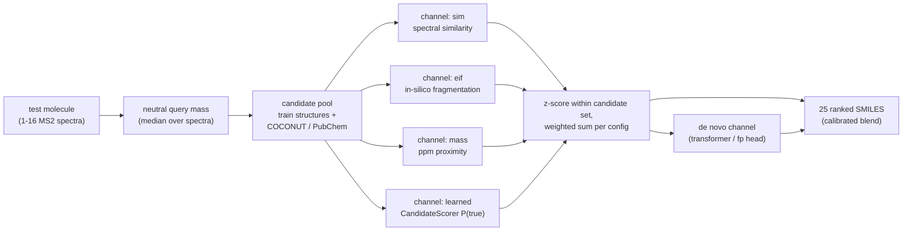

# Solution Architecture

The repo attacks the problem with a **multi-channel retrieve-then-rank pipeline**, informed by a strict local evaluation methodology. The three hidden novelty classes ([[concepts/competition/Novelty Classes]]) decompose the problem:

Two parallel development branches in the repo:

- **`src/enveda_casmi26/` + `scripts/`** — the full pipeline for all classes: candidate retrieval by neutral-mass window, in-silico fragmentation explained-intensity channel, contrastive candidate scorer, de novo transformer + fingerprint head, COCONUT pool, kernel export path ([[summaries/repo-solution-code]]).
- **`max_class1_exp/`** — a focused, deeply-validated experiment on class-1 retrieval and re-ranking ([[summaries/max-class1-readme]]).

Sub-pages:

- [[concepts/solution/Evaluation Strategy]] — leak-free local splits, the simulator, honest measurement
- [[concepts/solution/Retrieval]] — stage 1: mass window, entropy similarity, neutral losses
- [[concepts/solution/Re-ranking]] — stage 2: learned shortlist re-ranker, features, leakage rules
- [[concepts/solution/De Novo Channel]] — spectrum→SMILES transformer and fingerprint head
- [[concepts/solution/Candidate Pools]] — train + COCONUT/PubChem pools and class implications
- [[concepts/solution/Submission Architecture]] — offline kernel constraints, scorer export, channel fusion
- [[concepts/solution/Roadmap]] — stage 3 embeddings and open ideas

Everything is validated locally before any Kaggle submission ([[concepts/solution/Evaluation Strategy]]); experiment tracking via MLflow.
