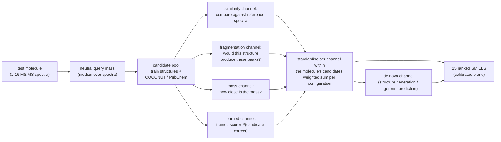

# Solution Architecture

The repo solves the problem with a **two-stage pipeline — first retrieve candidates, then rank them** — guided by a strict local evaluation methodology. The three hidden novelty classes ([[concepts/competition/Novelty Classes]]) decompose the work:

Two parallel development branches live in the repo:

- **`src/enveda_casmi26/` + `scripts/`** — the full pipeline for all classes: candidate retrieval by mass window, in-silico fragmentation scoring, a trained candidate scorer, structure generation plus fingerprint prediction, the COCONUT database extract, and the Kaggle-notebook export path ([[summaries/repo-solution-code]]).
- **`max_class1_exp/`** — a focused, carefully validated experiment on class-1 retrieval and re-ranking ([[summaries/max-class1-readme]]).

Sub-pages:

- [[concepts/solution/Evaluation Strategy]] — leak-free local splits, the simulator, honest measurement
- [[concepts/solution/Retrieval]] — stage 1: mass window, entropy similarity, neutral losses
- [[concepts/solution/Re-ranking]] — stage 2: learned re-ranking of the retrieved shortlists
- [[concepts/solution/De Novo Channel]] — spectrum→SMILES generation and fingerprint prediction
- [[concepts/solution/Candidate Pools]] — train structures + COCONUT/PubChem, and which classes each makes reachable
- [[concepts/solution/Submission Architecture]] — offline Kaggle-notebook constraints, scorer export, channel fusion
- [[concepts/solution/Roadmap]] — planned embedding stage and open ideas

Vocabulary: [[concepts/Glossary]].

Everything is validated locally before any Kaggle submission ([[concepts/solution/Evaluation Strategy]]); experiment tracking via MLflow.
